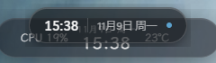
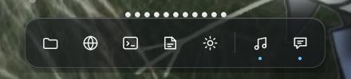

# GlassSuite

A glass-styled desktop suite for Windows: a **top island** (clock, media, notifications, system stats,
lyrics) and a **bottom dock** (pinned apps, running-app indicators, drag reorder, start menu, window
previews) — running as **one process, several frameless windows**.

> [!WARNING]
> **发行包未签名，安装时 Windows SmartScreen 会拦截。**
> **Releases are unsigned — Windows SmartScreen will warn on first launch.**
> This is a pre-release open-source build, not a commercially signed product. Verify the published
> `SHA256SUMS` against the artifact before running it, and only run builds you got from this repo's
> Releases page. Do **not** disable SmartScreen globally; use "More info → Run anyway" on the specific
> file if you have verified its checksum.
>
> Status: **pre-release / 开发中**. Public versioning starts at `0.1.0`; no stable API yet.

## Screenshots

Real captures of the two surfaces (glass visual baseline, taken at the P2 milestone; the current build
adds media / notification / lyrics / real system icons / start menu / previews on top of the same
visual language):

| Island (top) | Dock (bottom) |
|---|---|
|  |  |

Full-resolution and later-milestone captures live in the local, git-ignored `artifacts/` directory —
`artifacts/` is deliberately never committed (see [CONTRIBUTING.md](CONTRIBUTING.md)).

## Features

- **One process, shared state.** One WebView2 runtime, one GPU pipeline, one event loop. Full-screen
  yielding, taskbar geometry, DPI and z-order are decided once for every window.
- **Island**: clock/date, optional weather, battery, SMTC media with artwork + seekable progress,
  privacy-preserving notification *summary* (no body), optional lyrics, local-rule insights, hover to
  expand a metrics panel.
- **Dock**: pinned shortcuts, transient running-app icons, drag reorder (persisted), detached "free"
  icons, start-menu panel, DWM hover previews, auto-hide / bottom-edge reveal.
- **Everything that can hang is bounded**: process enumeration 2 s, icon extraction 800 ms, DWM
  preview 400 ms, notification WAL scan 5 s, menu scan 2 s, launch 1 s. A timeout degrades to a
  placeholder instead of freezing the island (same process — a stuck dock would otherwise stuck both).
- **Migrates old `glassdesk` config** automatically; see
  [docs/migrate-from-glassdesk-glasspill.md](docs/migrate-from-glassdesk-glasspill.md).

## Layout

```
apps/dock            bottom dock frontend (React + Vite)
apps/island          top island frontend (React + Vite)
packages/ipc-types   IPC contract shared by frontends and Rust
packages/shared-ui   glass surface primitives + fit-window hook + CSS tokens
crates/winplat       Windows platform layer (geometry, DPI, fullscreen, styles, logging, config)
src-tauri            Tauri shell, shared state, island/* and dock/* domains
docs                 architecture, migration guide, screenshots
licenses             OFL-1.1 text (for any future bundled font; none is bundled today)
```

See [docs/architecture.md](docs/architecture.md) for the process/thread model and the `winplat`
boundary. Rule of thumb: **a frontend never computes window placement** — it reports content size.

## Requirements

Windows 10/11 (x64), Node 20+, pnpm 11+, Rust stable (MSVC toolchain), WebView2 runtime.

## Build

```powershell
pnpm install
pnpm -r build                 # builds dist/dock and dist/island
pnpm check                    # typecheck every workspace package
cargo fmt --all -- --check
cargo clippy --workspace --all-targets -- -D warnings
cargo test --workspace
pnpm tauri build              # NSIS installer + portable zip in src-tauri/target/release/bundle
```

`pnpm tauri build` needs `@tauri-apps/cli`; see [Install](#install) for the released binaries if you
only want to run the app.

## Install

Releases publish two artifacts plus `SHA256SUMS`:

- `GlassSuite_<version>_x64-setup.exe` — NSIS installer, **per-user** (`perMachine=false`), no admin
  rights required.
- `GlassSuite_<version>_x64-portable.zip` — unzip anywhere and run `GlassSuite.exe`; settings live in
  `%APPDATA%\com.glasssuite.app\`.

Both are **unsigned**: expect the SmartScreen warning described at the top. Verify the checksum first:

```powershell
Get-FileHash .\GlassSuite_0.1.0_x64-setup.exe -Algorithm SHA256
# compare with SHA256SUMS from the release
```

On first launch the app creates `settings.json` with **every network/privacy feature off**. Fill in
`weather`, `networkProbeUrl`, `aiBaseUrl`, `lyricsSourceUrl` or `notifications.enabled` only if you
actually want them. Old `dev.glassdesk.app\dock.json` / `menu.json` are copied once, never overwritten.

## Mouse hook (click-through)

GlassSuite installs **one** low-level mouse hook (`WH_MOUSE_LL`) on its own main thread. It is used
**only to read the cursor position**: the position is compared with the hot zones reported by the
island and the dock, in order to toggle mouse pass-through and to reveal the dock at the screen edge
(4 px / 800 ms).

- It does not read key strokes, window titles, clipboard, or notification contents, and stores
  nothing.
- Nothing is uploaded; nothing is injected into any other process.
- If the hook cannot be installed, both windows stay interactive (degraded mode) rather than
  becoming unclickable ghost windows.

The dock's legacy 200 ms `GetCursorPos` polling is deliberately **not** carried over — one process,
one cursor observer, one meaning of "revealed".

## Privacy

GlassSuite is **local-only**:

- It reads the list of running applications to show indicators, and (only when you enable it) reads
  local notification data to show a one-line summary. **Nothing is uploaded anywhere.** No telemetry,
  no analytics, no crash-reporting endpoint.
- Network access only happens for features you enable yourself (weather with a location you set,
  optional lyrics source, optional AI with **your own** endpoint and key). There is **no built-in or
  fallback API endpoint** in the source tree.
- Process names/paths, notification bodies, URLs and API keys are **never written to logs**; logs
  contain only event types and counts.
- Notification bodies never reach the frontend or disk at all — Windows' own toast banner shows them.

## Icons, fonts and trademarks

- Application icons are fetched at **runtime** through Windows shell APIs (`SHGetFileInfoW` etc.) from
  the user's own machine. **No third-party icon, logo or trademark file is redistributed** with this
  project. The fallback glyphs in `apps/dock/src/icons.tsx` are original line drawings.
- **No font files are bundled.** The UI uses system font families (`Segoe UI Variable`, `Microsoft
  YaHei UI`, `system-ui`). The old project shipped two ~19 MB font files without a license file;
  dropping them saves 38,068,020 bytes (~36.3 MiB) per source tree. `licenses/OFL-1.1.txt` holds the
  SIL OFL 1.1 text for the day a subsetted font is ever added — it currently applies to no file.
- All deprecated code from the two predecessor projects (taskbar duplicate, `Eyes.*`, mouse polling,
  empty `main.rs`, `*_poc` binaries) was **not** imported. Full list in the migration guide.

## Contributing

See [CONTRIBUTING.md](CONTRIBUTING.md). Short version: `cargo fmt`, `clippy -D warnings`,
`cargo test --workspace`, `pnpm check` and `pnpm -r build` must all pass; never commit `artifacts/`,
never add a hardcoded personal path or a private endpoint, and never weaken the "default offline"
rule.

## License

GPL-3.0. See [LICENSE](LICENSE) and [NOTICE.md](NOTICE.md) for third-party components.
